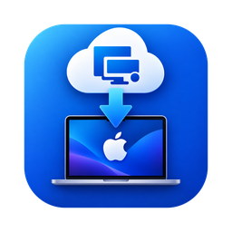
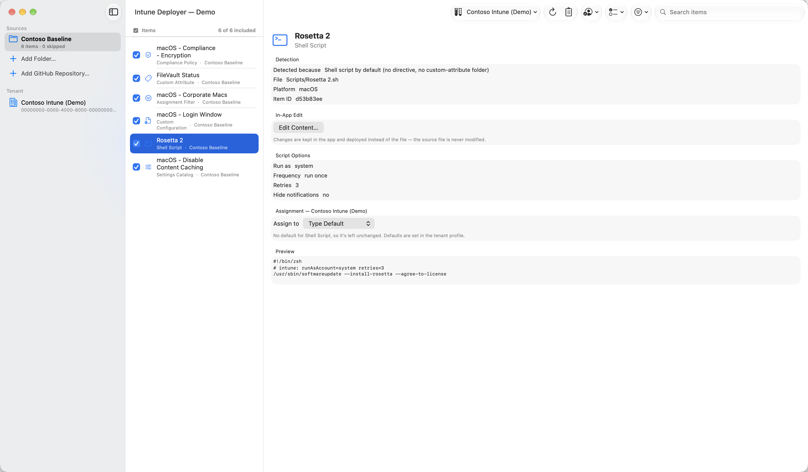
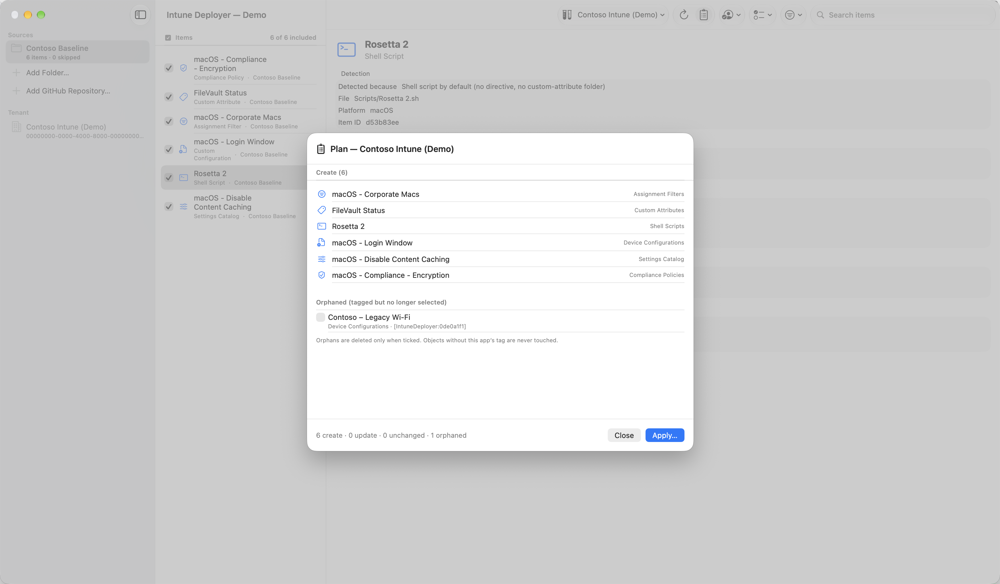
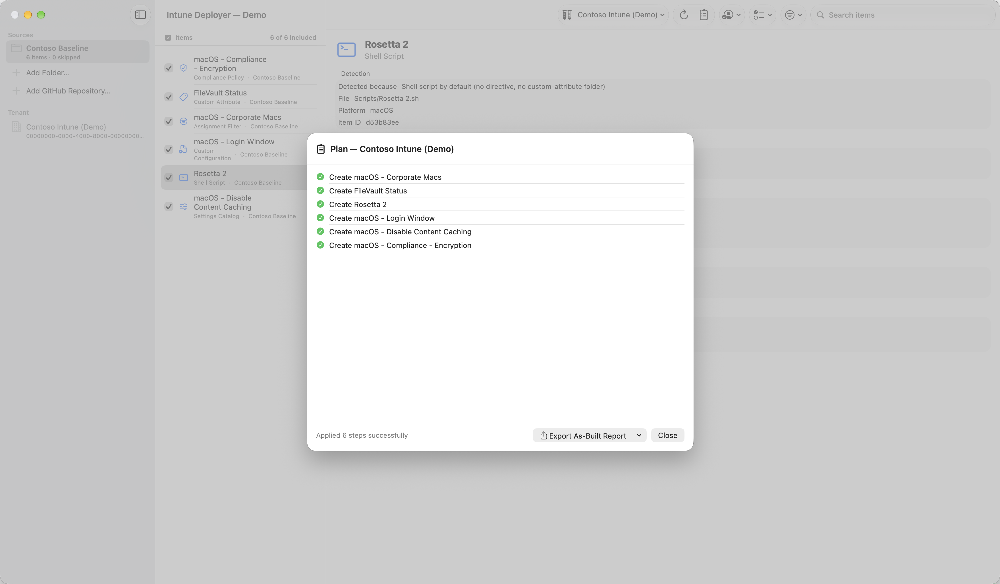

<p align="center">
  
</p>

# Intune Deployer

*Populate an Intune tenant without the clicking.*

[](https://github.com/JordyThery/intune-deployer/releases/latest)

[](LICENSE)

An open source macOS app that deploys macOS and iOS/iPadOS configuration to
Microsoft Intune.

Point it at one or more folders (or GitHub repositories) of plain configuration
files — Settings Catalog JSON, `.mobileconfig` profiles, compliance policies,
shell scripts, custom attributes, assignment filters, app packages — pick what
you want, review a dry-run plan, and apply it to a Microsoft Intune tenant
through Microsoft Graph. No manifests, no PowerShell.

- **Dry-run by default.** Nothing is written to a tenant without an explicit
  Apply with a confirmation summary.
- **Idempotent.** Objects created by the app carry an identity tag
  (`[IntuneDeployer:xxxxxxxx]` in the description) and the tag of the tenant
  profile that deployed them (`[IntuneDeployerProfile:xxxxxxxx]`). Re-runs
  update instead of duplicating, and send assignments only when they differ
  from the tenant’s; objects without the tag are never modified or deleted.
- **One profile per tenant.** Each tenant profile has its own app
  registration, account, item selection, variables and assignment intents.



| Dry-run plan | Apply results |
| --- | --- |
|  |  |

Requires macOS 15 or later, and a Microsoft Intune tenant with one app
registration per tenant (see Setup).

## Download

Grab the signed and notarized app from the
[latest release](https://github.com/JordyThery/intune-deployer/releases/latest),
or build from source (see below).

The app checks GitHub once a day for a newer release (turn this off in
**Settings › Updates**, or check manually via **Intune Deployer › Check for
Updates…**). Because the app is sandboxed it downloads the update for you to
replace in Applications, rather than installing itself.

On first launch the app shows a guided tour of the workflow; replay it any
time from **Help › Guided Tour**.

## Demo Mode

To look around without a tenant, choose **Try Demo Mode** in the sidebar
(shown while no tenant profile is saved), or turn on Demo Mode from the
tenant picker in the toolbar or the **Connection** menu. The app then works
with "Contoso Intune (Demo)", a sample tenant inside the app: nothing is
sent to a real tenant and no sign-in is needed. Plan, Apply, Remove
Baseline, tenant export and Preflight run for real against the sample
tenant, with their usual confirmations. Your baseline sources, item edits
and platform choices stay as they are.

## Setup

### 1. Create an app registration (per tenant)

For every Microsoft Entra tenant you deploy to, an admin creates one app registration in
that tenant:

1. [Microsoft Entra admin center](https://entra.microsoft.com) › **App registrations** ›
   **New registration**.
2. Name it (e.g. "Intune Deployer"), choose **Accounts in this organizational
   directory only**, and register. **No client secret or certificate** — the
   app is a public client.
3. **Authentication** › **Add a platform** › **iOS / macOS**, then enter the bundle
   ID `be.jordythery.intune-deployer`. This registers the redirect URI
   `msauth.be.jordythery.intune-deployer://auth`.
4. Copy the **Application (client) ID** and the **Directory (tenant) ID**
   (Overview page).

In the app, add a tenant profile in **Settings › Connections** (the **+**
button) or from the **Connection** menu with those two values. Instead of the
tenant ID you can enter one of the tenant’s verified domains
(e.g. `contoso.onmicrosoft.com`); the editor says when the value is neither.
When no tenant is in use yet, a new or imported profile becomes the one in
use; otherwise choose it in the toolbar (or the **Connection** menu). Then
sign in from the toolbar with an account that has sufficient Intune
permissions in that tenant. Microsoft Graph permissions are requested
incrementally and need admin consent on first use.

### 2. Graph permissions

All permissions are **delegated** (the app acts as the signed-in user; what it
can do is the intersection of these scopes and the user’s Intune RBAC role).

| Scope | Used for | When requested |
| --- | --- | --- |
| `User.Read` | Identifying the signed-in account | Sign-in |
| `DeviceManagementConfiguration.Read.All` | Reading profiles, compliance, filters, Settings Catalog | Sign-in |
| `DeviceManagementScripts.Read.All` | Reading shell scripts and custom attributes | Sign-in |
| `DeviceManagementServiceConfig.Read.All` | Preflight: MDM authority, APNs certificate, ADE tokens | Sign-in |
| `DeviceManagementApps.Read.All` | Reading apps | Sign-in |
| `Group.Read.All` | Resolving assignment group names | First Plan |
| `DeviceManagementConfiguration.ReadWrite.All` | Creating/updating profiles, compliance, filters | First Apply |
| `DeviceManagementScripts.ReadWrite.All` | Creating/updating scripts and custom attributes | First Apply |
| `DeviceManagementApps.ReadWrite.All` | Creating/updating apps and uploading content | First Apply |
| `Group.ReadWrite.All` | Creating missing static groups (opt-in per profile); deleting empty groups the profile created on Remove Baseline | First Apply with group creation enabled, or Remove Baseline when it deletes groups |

### 3. Baseline sources

Add a **local folder** or **any GitHub repository** (owner/repo, optional
subfolder, optional release tag prefix such as `macos-v`). GitHub sources
download the latest matching published release (or the default branch when the
repo has no releases), are cached locally, and show an update badge when a
newer matching release exists (checked at launch, on refresh (⌘R), and from
the source’s context menu). Private repositories work with a fine-grained personal
access token (read-only Contents permission), stored in the Keychain via
**Settings › GitHub**.

Removing a source and adding the same one again later (the same GitHub
owner/repo/subfolder, or a folder with the same name) keeps its items’
identities, so Plan updates the objects they deployed instead of creating new
ones. Plan doesn’t run while a chosen item may be in a source that isn’t
scanned (a failed sync, a drive that isn’t mounted): refresh the sources
first, so nothing is offered for deletion by mistake.

## How files become Intune objects

The app scans sources recursively and infers each item from the file itself:

| File | Detected as | Display name |
| --- | --- | --- |
| `.json` with `@odata.type` | Settings Catalog, compliance policy, custom configuration, or assignment filter | `name` / `displayName` |
| `.json` with `settings` + `platforms` + `technologies` | Settings Catalog policy | `name` |
| `.json` with `rule` + `platform` | Assignment filter | `displayName` |
| `.mobileconfig` | Custom configuration profile (signed profiles are reported as unsupported) | `PayloadDisplayName`, else filename |
| `.sh` / `.zsh` | Shell script, or custom attribute (see below) | Filename without extension |
| `.pkg` / `.dmg` | macOS app (macOSPkgApp / macOSDmgApp); bundle ID and version are read from the package at plan time | Filename without extension |
| `.ipa` | iOS app (iosLobApp, preview); bundle ID, version and provisioning expiry are read from the package at plan time | Filename without extension |

### Platforms

Every item targets macOS or iOS/iPadOS; the platform is shown in the item
list and can be filtered on. JSON files state their platform themselves
(`platforms`, `platform` or the `@odata.type`), `.ipa` packages are always
iOS/iPadOS, and scripts, custom attributes and `.pkg`/`.dmg` packages are
always macOS. A `.mobileconfig` can’t state its platform: it defaults to
macOS and can be switched per item with the **Platform** picker in the item
details (or **Set Platform** with several items selected). The choice is kept
inside the app, so it survives source syncs. The one path convention: profiles
under a top-level `iOS and iPadOS` folder — the tenant export layout — start
as iOS/iPadOS.

Graph exports and [IntuneManagement](https://github.com/Micke-K/IntuneManagement)
exports both work; read-only and tool-specific keys are stripped before upload.
Everything else (READMEs, images, other tools’ `.xml` manifests) is listed
under **Skipped** with a reason.

### Scripts: shell script or custom attribute?

1. A header directive wins:

   ```bash
   #!/bin/zsh
   # intune: type=customAttribute attributeType=string
   ```

2. Otherwise, a folder named like `CustomAttributes` / `Custom Attributes`
   anywhere in the path makes it a custom attribute.
3. Otherwise it is a shell script.

Shell script options also come from the directive (first 15 lines):

```bash
# intune: runAsAccount=user frequency=1440 retries=3 hideNotifications=true
```

| Key | Values |
| --- | --- |
| `type` | `shellScript`, `customAttribute` |
| `attributeType` | `string`, `integer`, `dateTime` |
| `runAsAccount` | `system`, `user` |
| `frequency` | minutes between runs (omit = run once) |
| `retries` | retry count |
| `hideNotifications` | `true` / `false` |

### Editing items in the app

With item editing turned on in **Settings › General**, every item except app packages gets
an **Edit Content…** button in its detail view. Edits are kept inside the app
and deployed instead of the file — **the source file is never modified**.
Edited items are marked in the list and in every plan, show an
Original/Edited preview, and can be reverted with one click. When a source
later changes (a new release, an edited file): if it now matches your edit
the edit clears itself; if it changed differently the item is flagged and its
details offer **Keep My Edit** or **Use Source Version…**. If the file
disappears, the edit is kept until you revert it. An edit may change values
and names but not what type of object the file is. The editor shows the
content as it is (one-line JSON is indented, with keys in their original
order); binary profiles and files that aren’t UTF-8 text can’t be edited.

### Variables

Files may contain `{{TokenName}}` placeholders (JSON values, mobileconfig
strings, scripts). Values are set per tenant profile and substituted at plan
time; Apply is blocked while any selected item has an unresolved token.

### Assignments

Per item and per tenant: leave unchanged, or one or more targets — all
devices, all users, or a static Microsoft Entra group resolved by display name
(optionally created on Apply when enabled in the profile). Groups can also be
**excluded**; exclusions take precedence in Intune and can’t carry a filter.
Including and excluding the same group is a plan error. Applying an item’s
assignments replaces the full set in Intune; if any target can’t be
resolved, the plan reports an error and the existing set is left as it is.
The tenant profile can also set **default targets per item type** (e.g. all
shell scripts: all devices); items without their own
assignment follow it, and an item’s editor can override it or switch back to
**Type default**. A new target, in an item’s editor or as a type default,
starts as a group still to be named: all devices and all users are always an
explicit choice. Select several items (⇧/⌘-click, ⌘A) to edit their
assignments in one place or use the right-click menu; the list header
checkbox and the **Selection** toolbar menu include or exclude everything
currently shown. Included targets can carry an include/exclude assignment filter
(except on shell scripts and custom attributes: Intune doesn’t support
filters there, so the app hides the fields and plans them without one). A
filter’s platform must match the item’s; built-in ADE filter templates are
available per platform, created from
`(device.enrollmentProfileName -eq "{{EnrollmentProfileName}}")`.
The app warns when a dynamic device group is used — delivery of
enrollment-critical policies may be delayed past Await Configuration.
App assignments install as **Required** by default; choose **Available in
Company Portal** in the assignment editor for self-service installs
(user assignments only).

### Apps (.pkg / .dmg / .ipa)

App packages are encrypted locally (AES-256-CBC + HMAC-SHA256, the format
Intune expects), uploaded to Azure Storage in chunks, committed, and published
before assignment. Bundle ID/version come from the package itself —
`Distribution`/`PackageInfo` for .pkg, the app bundle’s Info.plist for .dmg
and .ipa. The publisher field defaults to the app name; adjust it in the
Intune admin center if needed. Re-uploads happen only when the bundle version, build number or file
name changes (for an `.ipa`, also the provisioning expiry).
Reading a package at plan time may take five minutes plus a minute per GB;
a package that takes longer is a plan error that says so.

`.ipa` support is a **preview**: the upload follows Microsoft’s LOB sample,
but it has not yet been verified against a production deployment. The .ipa
must be signed — the provisioning profile’s expiration date is required by
Intune, and the plan warns when it expires within 30 days.

## Exporting from a tenant

Select the tenant in use in the sidebar to see its existing objects. Choose
**Export All** in the toolbar, or select objects and choose **Export…** from
the context menu, then pick a folder. Each object is saved in the format the
app reads back, grouped by platform and type (`macOS/Compliance`,
`iOS and iPadOS/Settings Catalog`, …), so the folder can be added as a source
directly:

| Object | Exported as |
| --- | --- |
| Settings Catalog policy | `.json` including its settings |
| Compliance policy | `.json` including scheduled actions |
| Custom configuration profile | The original `.mobileconfig` |
| Assignment filter | `.json` |
| Shell script | `.sh` with an `# intune:` directive for its run options |
| Custom attribute | `.sh` in a `CustomAttributes` folder |

Exports are cleaned: read-only Graph fields, the identity and profile tags and
the tenant profile’s naming prefix are removed, and assignments are not included. App
packages and objects for platforms other than macOS and iOS/iPadOS are
skipped, and existing files are never overwritten. Exported objects carry no
identity tag, so deploying an export back into the **same** tenant creates new objects next to the
originals — exports are meant for other tenants.

## Where to get baseline files

The app ships with no baseline content. These community projects are optional
starting points — **review everything before using it in production**:

- [microsoft/intune-my-macs](https://github.com/microsoft/intune-my-macs) —
  use the `macOS/` folder (MIT license). Its `.xml` manifests are not needed
  and are ignored automatically.
- [SkipToTheEndpoint/OpenIntuneBaseline](https://github.com/SkipToTheEndpoint/OpenIntuneBaseline) —
  use the `MACOS/` folder (GPL-3.0 license); releases are tagged per platform,
  so set the tag prefix to `macos-v`.

Add either as a GitHub source with the subfolder set accordingly; the license
and release tag are shown with every item.

## Safety model

- Plan (⌘P) is read-only and shows creates, field-level update diffs,
  unchanged items, warnings and errors; Apply stays disabled while errors
  exist. Settings Catalog updates list changed settings by name and value
  (e.g. *Restrictions › Allow Content Caching*, True → False); switch to
  **Raw** to see the field-level JSON changes. Reordered settings are not
  reported as changes; settings whose names can’t be read from the tenant
  show their definition ID.
- Orphaned objects (tagged but no longer selected) are only deleted when
  explicitly ticked, and only the tenant profile’s own objects are listed.
  Objects deployed before profile tags count as the profile’s when their name
  carries its naming prefix, or, without a prefix, when it is the only tenant
  profile for its tenant (Plan and Remove Baseline say when that can’t be
  decided yet because a tenant ID isn’t known). Tenants are compared by the tenant ID Microsoft’s
  sign-in names, so a profile with the tenant’s domain and one with its
  tenant ID count as the same tenant; a profile with a domain that hasn’t
  signed in yet counts as possibly the same. With two or more deletions ticked, Apply asks you
  to type the number of deletions first.
- **Remove Baseline** deletes the tenant profile’s own tagged objects, the
  built-in template filters it created, and the groups it created that still
  have no members (other groups its assignments name are listed and kept),
  after typing the tenant profile name to confirm. Other profiles’
  objects and untagged objects are never touched.
- Every write is sent only with a sign-in token of the profile’s tenant; a
  profile with a verified domain is checked against that tenant’s domains
  first. Apply refuses a plan made for another tenant profile.
- Each tenant profile should have its own naming prefix: Baseline Settings
  warns when another profile uses the same one, because objects deployed
  before profile tags are matched by prefix.
- A read-only preflight checklist verifies tenant readiness (MDM authority,
  Apple MDM push certificate and ADE token expiry), and the tenant view lists
  every object the app manages.
- When Microsoft asks the app to wait before trying a request again, the
  wait is shown at the bottom of the window with **Stop**. Stop ends the wait;
  that request isn’t sent again, and Apply or Remove Baseline sends nothing
  after it. A stopped update, assignment or deletion may already have been
  carried out: the results say so; run Plan again to see.
- Plan, sign-in, Baseline Settings, Preflight, the inventory, export and
  Remove Baseline are also in the **Tenant** menu. While a Plan, Remove
  Baseline, Preflight or Baseline Settings sheet is open, they and the tenant
  picker are unavailable, so the plan on screen stays as it is.
- An as-built report (Markdown or HTML) can be exported after every Apply;
  variable values are masked (••••) where a variable is used, also in item
  names, and longer values also in the Apply steps’ messages. Tenant profiles can be exported and
  imported as JSON (Settings › Connections). An export carries the identities
  of its sources, so on another Mac add the same sources and the items keep
  their identities.
- Saved files the app can’t read (sources, item edits, platform choices) are
  copied aside and never saved over; a notice at the bottom of the window says so.
- The activity log (⇧⌘L) records every Graph, GitHub and upload request
  (method, address, status and redacted headers). It never records tokens or
  request bodies; error responses are recorded with secrets redacted.

## Network and stored data

The app contacts only:

- `login.microsoftonline.com` (Microsoft sign-in through MSAL) and
  `graph.microsoft.com` (reading and writing Intune objects);
- Azure Storage, at the upload address Intune gives for each app package;
- `api.github.com` and `github.com`, for GitHub sources and the daily update
  check.

Tenant profiles, sources, item edits, platform choices and the GitHub cache
are stored in `~/Library/Containers/be.jordythery.intune-deployer/Data/Library/Application Support/Intune Deployer`.
The GitHub token is in the Keychain (service
`be.jordythery.intune-deployer.github`); Microsoft sign-ins are kept by MSAL
in the Keychain.

## Building from source

1. Open `Intune Deployer.xcodeproj` in Xcode 26 or later. Swift Package
   Manager resolves JTKit and, through it, MSAL 2.16.0 on first build.
2. Set your own development team and (optionally) bundle ID — remember the
   bundle ID is part of the redirect URI your app registrations must use.
3. Build and run (macOS 15+). Tests: ⌘U.

The app’s only package dependency is
[JTKit](https://github.com/JordyThery/JTKit), the shared package of these
apps. Resolving it also downloads Microsoft’s MSAL, which JTKit uses for
Intune sign-in; this app links and ships it for that sign-in (see
[THIRD-PARTY-NOTICES.md](THIRD-PARTY-NOTICES.md)).

## Support

If Intune Deployer saves you time, you can [buy me a coffee](https://buymeacoffee.com/jordythery). ☕️

## Disclaimer

This tool is provided as-is, without warranty of any kind. Use it at your own risk. This is a personal project. It is not affiliated with or endorsed by my employer, Apple or Microsoft. Issues and pull requests are appreciated. Support is best-effort.

## License

[MIT](LICENSE) — © 2026 Jordy Thery.
