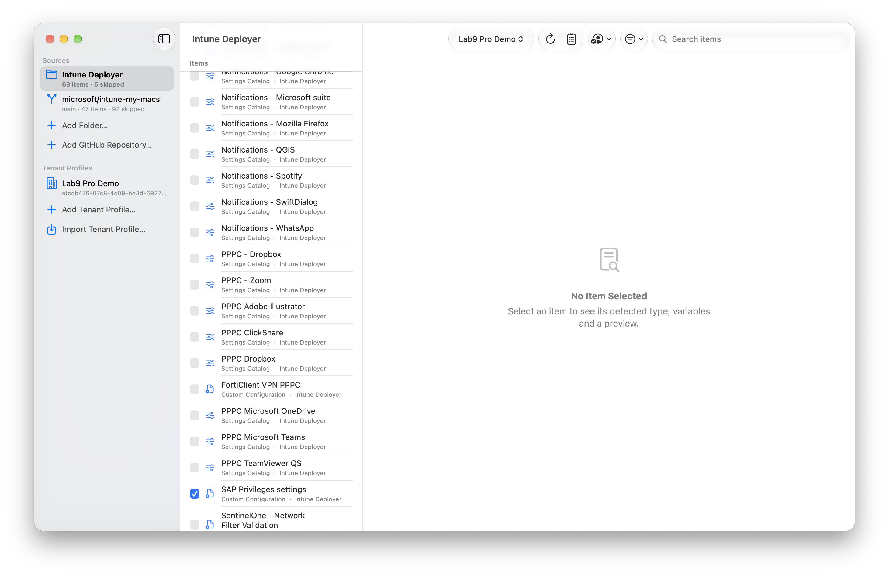
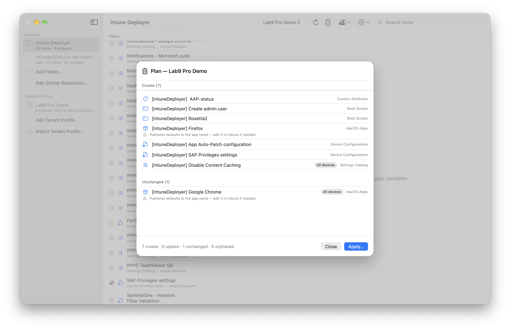
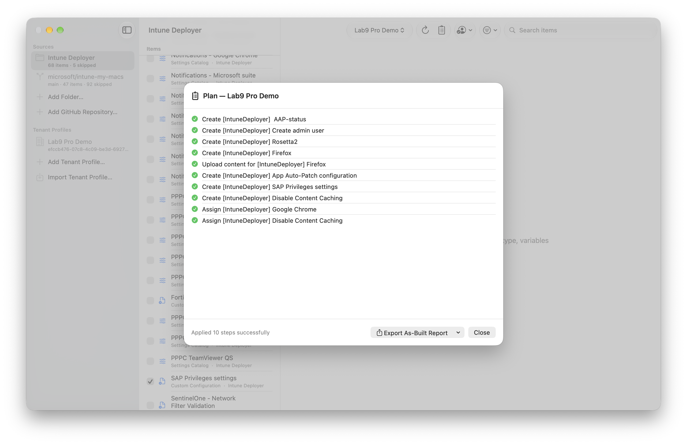

# Intune Deployer

An open source macOS app that deploys macOS configuration to Microsoft Intune.

Point it at one or more folders (or GitHub repositories) of plain configuration
files — Settings Catalog JSON, `.mobileconfig` profiles, compliance policies,
shell scripts, custom attributes, assignment filters — pick what you want,
review a dry-run plan, and apply it to an Entra tenant through Microsoft Graph.
No manifests, no PowerShell.

- **Dry-run by default.** Nothing is written to a tenant without an explicit
  Apply with a confirmation summary.
- **Idempotent.** Objects created by the app carry an identity tag
  (`[IntuneDeployer:xxxxxxxx]` in the description). Re-runs update instead of
  duplicating; objects without the tag are never modified or deleted.
- **Multi-tenant.** Each tenant profile has its own app registration, account,
  item selection, variables and assignment intents.



| Dry-run plan | Apply results |
| --- | --- |
|  |  |

Requires macOS 15 or later.

## Download

Grab the signed and notarized app from the
[latest release](https://github.com/JordyThery/intune-deployer/releases/latest),
or build from source (see below).

## Setup

### 1. Create an app registration (per tenant)

For every Entra tenant you deploy to, an admin creates one app registration in
that tenant:

1. [Entra admin center](https://entra.microsoft.com) → **App registrations** →
   **New registration**.
2. Name it (e.g. "Intune Deployer"), choose **Accounts in this organizational
   directory only**, and register. **No client secret or certificate** — the
   app is a public client.
3. **Authentication** → **Add a platform** → **iOS / macOS** → enter the bundle
   ID `be.jordythery.intune-deployer`. This registers the redirect URI
   `msauth.be.jordythery.intune-deployer://auth`.
4. Copy the **Application (client) ID** and the **Directory (tenant) ID**
   (Overview page).

In the app, add a tenant profile (sidebar → **Add Tenant Profile…**) with those two
values, then sign in from the toolbar with an account that has sufficient
Intune permissions in that tenant. Microsoft Graph permissions are requested
incrementally and need admin consent on first use.

### 2. Graph permissions

All permissions are **delegated** (the app acts as the signed-in user; what it
can do is the intersection of these scopes and the user's Intune RBAC role).

| Scope | Used for | When requested |
| --- | --- | --- |
| `User.Read` | Identifying the signed-in account | Sign-in |
| `DeviceManagementConfiguration.Read.All` | Reading profiles, compliance, filters, Settings Catalog | Sign-in |
| `DeviceManagementScripts.Read.All` | Reading shell scripts and custom attributes | Sign-in |
| `DeviceManagementServiceConfig.Read.All` | Preflight: MDM authority, APNs certificate, ADE tokens | Sign-in |
| `DeviceManagementApps.Read.All` | Reading macOS apps | Sign-in |
| `Group.Read.All` | Resolving assignment group names | First Plan |
| `DeviceManagementConfiguration.ReadWrite.All` | Creating/updating profiles, compliance, filters | First Apply |
| `DeviceManagementScripts.ReadWrite.All` | Creating/updating scripts and custom attributes | First Apply |
| `DeviceManagementApps.ReadWrite.All` | Creating/updating macOS apps and uploading content | First Apply |
| `Group.ReadWrite.All` | Creating missing static groups (opt-in per profile) | First Apply with group creation enabled |

### 3. Baseline sources

Add a **local folder** or **any GitHub repository** (owner/repo, optional
subfolder, optional release tag prefix such as `macos-v`). GitHub sources
download the latest matching published release (or the default branch when the
repo has no releases), are cached locally, and show an update badge when a
newer matching release exists (checked at launch, on refresh, and from the
source's context menu). Private repositories work with a fine-grained personal
access token (read-only Contents permission), stored in the Keychain via
**Settings → GitHub Access**.

## How files become Intune objects

The app scans sources recursively and infers each item from the file itself:

| File | Detected as | Display name |
| --- | --- | --- |
| `.json` with `@odata.type` | Settings Catalog, macOS compliance policy, macOS custom configuration, or assignment filter | `name` / `displayName` |
| `.json` with `settings` + `platforms` + `technologies` | Settings Catalog policy | `name` |
| `.json` with `rule` + `platform` | Assignment filter | `displayName` |
| `.mobileconfig` | Custom configuration profile (signed profiles are reported as unsupported) | `PayloadDisplayName`, else filename |
| `.sh` / `.zsh` | Shell script, or custom attribute (see below) | Filename without extension |
| `.pkg` / `.dmg` | macOS app (macOSPkgApp / macOSDmgApp); bundle ID and version are read from the package at plan time | Filename without extension |

Graph exports and [IntuneManagement](https://github.com/Micke-K/IntuneManagement)
exports both work; read-only and tool-specific keys are stripped before upload.
Everything else (READMEs, images, other tools' `.xml` manifests) is listed
under **Skipped** with a reason.

### Scripts: shell script or custom attribute?

1. A header directive wins:

   ```bash
   #!/bin/zsh
   # intune: type=customAttribute attributeType=string
   ```

2. Otherwise, a folder named like `CustomAttributes` / `Custom Attributes`
   anywhere in the path makes it a custom attribute.
3. Otherwise it is a shell script.

Shell script options also come from the directive (first 15 lines):

```bash
# intune: runAsAccount=user frequency=1440 retries=3 hideNotifications=true
```

| Key | Values |
| --- | --- |
| `type` | `shellScript`, `customAttribute` |
| `attributeType` | `string`, `integer`, `dateTime` |
| `runAsAccount` | `system`, `user` |
| `frequency` | minutes between runs (omit = run once) |
| `retries` | retry count |
| `hideNotifications` | `true` / `false` |

### Variables

Files may contain `{{TokenName}}` placeholders (JSON values, mobileconfig
strings, scripts). Values are set per tenant profile and substituted at plan
time; Apply is blocked while any selected item has an unresolved token.

### Assignments

Per item and per tenant: leave unchanged, all devices, all users, or a static Entra group
resolved by display name (optionally created on Apply when enabled in the
profile). Assignments can carry an include/exclude assignment filter; a
built-in macOS ADE filter template is available:
`(device.enrollmentProfileName -eq "{{EnrollmentProfileName}}")`.
The app warns when a dynamic device group is used — delivery of
enrollment-critical policies may be delayed past Await Configuration.
App assignments use the *required* install intent.

### macOS apps (.pkg / .dmg)

App packages are encrypted locally (AES-256-CBC + HMAC-SHA256, the format
Intune expects), uploaded to Azure Storage in chunks, committed, and published
before assignment. Bundle ID/version come from the package itself —
`Distribution`/`PackageInfo` for .pkg, the app bundle's Info.plist for .dmg.
The publisher field defaults to the app name; adjust it in Intune if needed.
Re-uploads happen only when the bundle version or file name changes.

## Where to get baseline files

The app ships with no baseline content. These community projects are optional
starting points — **review everything before using it in production**:

- [microsoft/intune-my-macs](https://github.com/microsoft/intune-my-macs) —
  use the `macOS/` folder (MIT license). Its `.xml` manifests are not needed
  and are ignored automatically.
- [SkipToTheEndpoint/OpenIntuneBaseline](https://github.com/SkipToTheEndpoint/OpenIntuneBaseline) —
  use the `MACOS/` folder (GPL-3.0 license); releases are tagged per platform,
  so set the tag prefix to `macos-v`.

Add either as a GitHub source with the subfolder set accordingly; the license
and release tag are shown with every item.

## Safety model

- Plan (⌘P) is read-only and shows creates, field-level update diffs,
  unchanged items, warnings and errors; Apply stays disabled while errors
  exist.
- Orphaned objects (tagged but no longer selected) are only deleted when
  explicitly ticked.
- **Remove Baseline** deletes every tagged object in a tenant (including
  objects tagged by earlier builds) after typing the tenant profile name to
  confirm. Untagged objects are never touched.
- A read-only preflight checklist verifies tenant readiness (MDM authority,
  Apple MDM push certificate and ADE token expiry), and the tenant view lists
  every object the app manages.
- An as-built report (Markdown or HTML) can be exported after every Apply, and
  tenant profiles can be exported and imported as JSON.
- The activity log (⌘⇧L) records every Graph request — never tokens or
  payloads.

## Building from source

1. Open `Intune Deployer.xcodeproj` in Xcode 26 or later (the MSAL Swift
   package resolves on first build).
2. Set your own development team and (optionally) bundle ID — remember the
   bundle ID is part of the redirect URI your app registrations must use.
3. Build and run (macOS 15+). Tests: ⌘U.

## License

[MIT](LICENSE) — © 2026 Jordy Thery.
